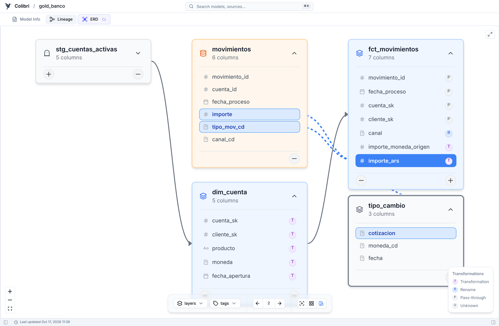
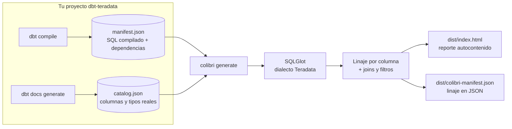
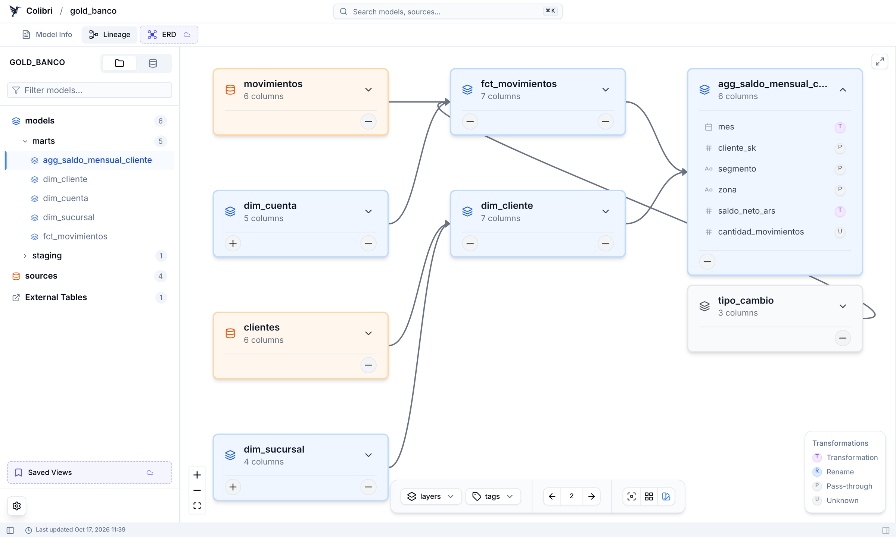
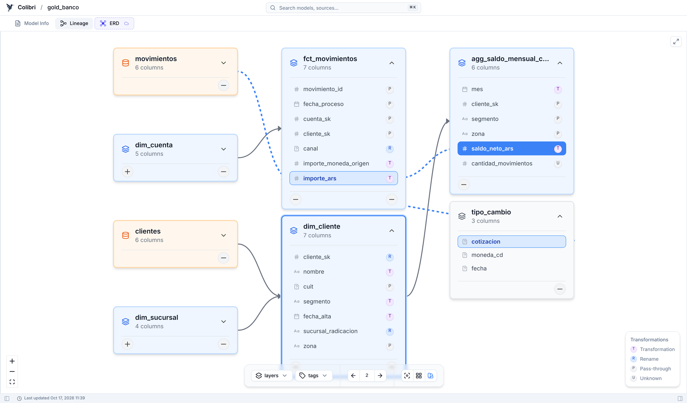
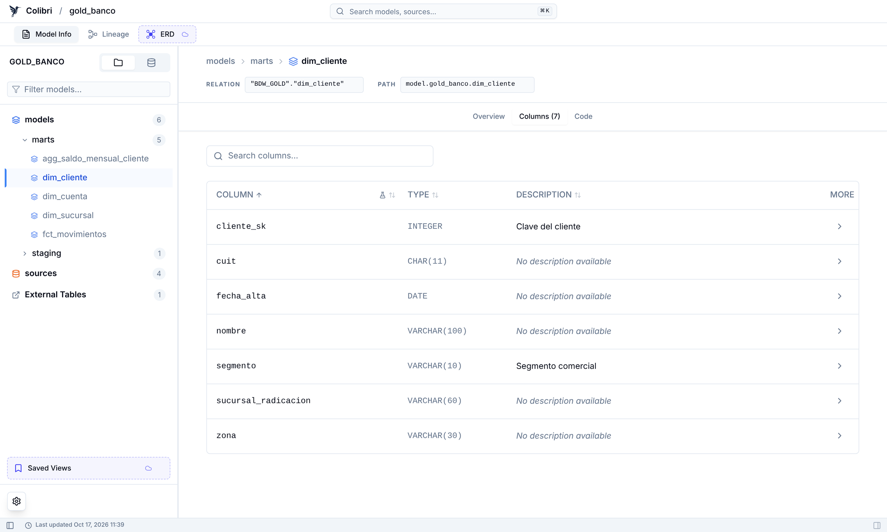
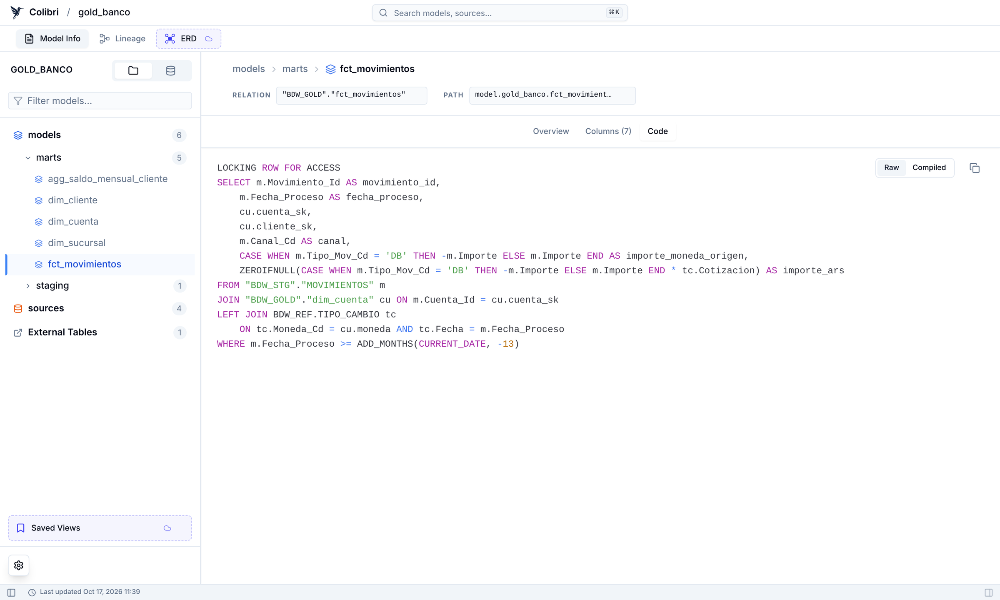
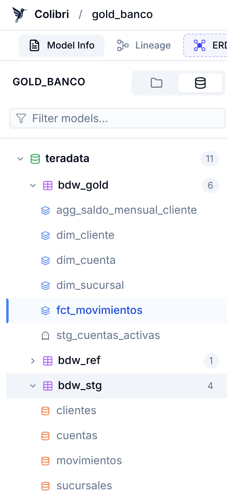

# dbt-colibri para Teradata

**Linaje a nivel de columna para proyectos dbt sobre Teradata.** Lee los artefactos que ya genera dbt (`manifest.json` y `catalog.json`), parsea el SQL compilado con el dialecto Teradata y arma un reporte HTML autocontenido donde cada columna se puede rastrear hasta su origen.

Es un fork de [b-ned/dbt-colibri](https://github.com/b-ned/dbt-colibri), recortado y adaptado para que funcione bien con `dbt-teradata`.



<sub>Seleccionando `fct_movimientos.importe_ars` se resaltan las tres columnas de las que sale: `importe` y `tipo_mov_cd` de staging, y `cotizacion` de una tabla de referencia que no está en dbt.</sub>

---

## En 30 segundos

```bash
pip install git+https://github.com/patriciojgf/dbt-colibri-teradata

dbt compile
dbt docs generate        # genera catalog.json, necesario para resolver columnas
colibri generate         # escribe dist/index.html
```

Abrís `dist/index.html` en el navegador y listo. Es un único archivo, sin servidor ni dependencias externas: se puede mandar por mail, subir a un share o publicar en GitHub/GitLab Pages.

```text
Welcome to dbt-colibri for Teradata 🐦
[INFO] Loading dbt manifest and catalog...
[INFO] Detected adapter type: teradata
[INFO] 1/6 ephemeral models not in catalog (columns derived from SQL).
[INFO] Running with configuration:
         dbt-colbri version : 0.3.6+td.1
         dbt version        : 1.10.4
         SQL dialect        : teradata
         dbt project        : gold_banco
[INFO] Extracting lineage data...
[INFO] Generating report...

✅ Report completed!
  📁 JSON: dist/colibri-manifest.json
  🌐 HTML: dist/index.html
```

## Cómo funciona



No se conecta a Teradata: trabaja solo con los archivos que dbt deja en `target/`.

---

## Qué te da

### 1. Linaje de modelos

Para cualquier modelo ves de qué depende y quién lo consume, con el botón **←/→** podés abrir más niveles hacia arriba o hacia abajo. Los sources aparecen en naranja, los modelos en azul y las tablas que no están en dbt en gris.



### 2. Linaje por columna, a través de varios saltos

Hacés clic en una columna y se resalta todo su camino. Acá `saldo_neto_ars` del agregado mensual viene de `fct_movimientos.importe_ars`, que a su vez sale de `movimientos` y de `tipo_cambio.cotizacion`:



Cada columna lleva una marca con el tipo de transformación:

| Marca | Tipo | Ejemplo en el demo |
|:---:|---|---|
| **P** | Pass-through: pasa sin cambios | `cuit` en `dim_cliente` |
| **R** | Rename: misma columna, otro nombre | `Canal_Cd AS canal` |
| **T** | Transformation: se calcula | `ZEROIFNULL(... * tc.Cotizacion) AS importe_ars` |
| **U** | Unknown: sin columna de origen | `COUNT(*) AS cantidad_movimientos` |

Además de las columnas del `SELECT`, registra qué columnas se usan en **joins** (`ON`) y **filtros** (`WHERE`, `HAVING`), así sabés qué se rompe aunque una columna no se proyecte.

### 3. Ficha de cada modelo

Columnas con tipo real de Teradata (del catálogo) y la descripción que pusiste en el YAML:



Y el SQL, tanto el raw como el compilado:



### 4. Vista por base de datos



Además de la vista por carpetas del proyecto, podés navegar por **base de datos de Teradata**, igual que en Teradata Studio.

Las tablas que se leen en el SQL pero no están declaradas como source (en el demo, `BDW_REF.TIPO_CAMBIO`) aparecen bajo su base, en este caso `bdw_ref`, marcadas como *hardcoded*. Sirve para encontrar dependencias que todavía no pasaron por `sources.yml`.

<br clear="right"/>

---

## SQL de Teradata soportado

| Construcción | Ejemplo |
|---|---|
| `SEL` abreviado | `SEL c.Cliente_Id AS cliente_sk ...` |
| `QUALIFY` | `QUALIFY ROW_NUMBER() OVER (PARTITION BY ...) = 1` |
| `LOCKING ROW FOR ACCESS` | al inicio de la consulta |
| `CAST ... FORMAT` | `CAST(c.Fecha_Alta AS DATE FORMAT 'YYYY-MM-DD')` |
| Funciones propias | `ZEROIFNULL`, `ADD_MONTHS`, `TRUNC(..., 'MM')` |
| `TOP`, `SAMPLE` | `SELECT TOP 10 ...`, `... SAMPLE 100` |
| Mayúsculas/minúsculas | `"BDW_STG"."clientes"` matchea con `CLIENTES` del catálogo |
| Modelos ephemeral | `JOIN __dbt__cte__stg_x s` se atribuye al modelo `stg_x` |

## Opciones

```bash
colibri generate --manifest target/manifest.json --catalog target/catalog.json --output-dir dist
```

| Opción | Por defecto | Para qué |
|---|---|---|
| `--manifest` | `target/manifest.json` | Ruta al manifest de dbt |
| `--catalog` | `target/catalog.json` | Ruta al catálogo de dbt |
| `--output-dir` | `dist` | Dónde escribir el HTML y el JSON |
| `--light` | apagado | Omite el SQL del reporte, para proyectos muy grandes |
| `--debug` | apagado | Logging detallado |
| `--enable-telemetry` | apagado | Ver abajo |

Por defecto **no hace ninguna llamada a internet**: no consulta PyPI y el reporte no envía telemetría. Si querés mandarle estadísticas anónimas al proyecto original, agregá `--enable-telemetry`.

## Publicarlo en cada deploy

Como es un HTML estático, alcanza con generarlo en el pipeline y publicarlo. Ejemplo para GitLab Pages:

```yaml
pages:
  stage: deploy
  script:
    - pip install dbt-teradata git+https://github.com/patriciojgf/dbt-colibri-teradata
    - dbt deps
    - dbt compile
    - dbt docs generate
    - colibri generate --output-dir public
  artifacts:
    paths: [public]
  only: [main]
```

`dbt docs generate` necesita conexión a Teradata para leer el catálogo, así que el runner tiene que llegar a la base.

## Probarlo sin un proyecto propio

Las capturas de este README salen de un proyecto demo incluido en el repo: un esquema estrella de un banco con staging, dimensiones, un fact incremental, un ephemeral y una tabla de referencia fuera de dbt.

```bash
python docs/demo/build_demo.py docs/demo/target
colibri generate --manifest docs/demo/target/manifest.json \
                 --catalog docs/demo/target/catalog.json \
                 --output-dir docs/demo/dist
```

## Diferencias con el proyecto original

- Solo acepta el adapter `teradata`; cualquier otro `adapter_type` se rechaza.
- Resuelve nombres de dos partes (`base.objeto`), que es como los emite dbt-teradata. Ignora el `database` del profile y el `database` nulo del catálogo.
- Trata los identificadores como Teradata: sin distinguir mayúsculas, aunque estén entre comillas.
- Ignora un `LOCKING ROW FOR ACCESS` inicial.
- Atribuye bien los ephemeral referenciados con alias, también en joins y filtros.
- Agrupa las tablas externas bajo su base de datos en el árbol.
- Sin chequeo de versión contra PyPI y con telemetría apagada por defecto.

## Limitaciones

- Las tablas OTF de Teradata (nombres de tres partes `datalake.db.tabla`) no se resuelven a nivel de columna.
- Los modelos Python se saltean.
- Si un modelo no está en `catalog.json` (por ejemplo, nunca se materializó), sus columnas no se pueden resolver.

## Desarrollo

```bash
uv sync --dev
uv run pytest
```

Los tests usan artefactos sintéticos con el formato real de dbt-teradata (`tests/teradata_fixtures.py`) y el proyecto demo.

## Licencia

MIT, ver [LICENSE](LICENSE). Basado en [dbt-colibri](https://github.com/b-ned/dbt-colibri) de bned, que a su vez se apoya en [dbt-column-lineage-extractor](https://github.com/canva-public/dbt-column-lineage-extractor) y [SQLGlot](https://github.com/tobymao/sqlglot).
